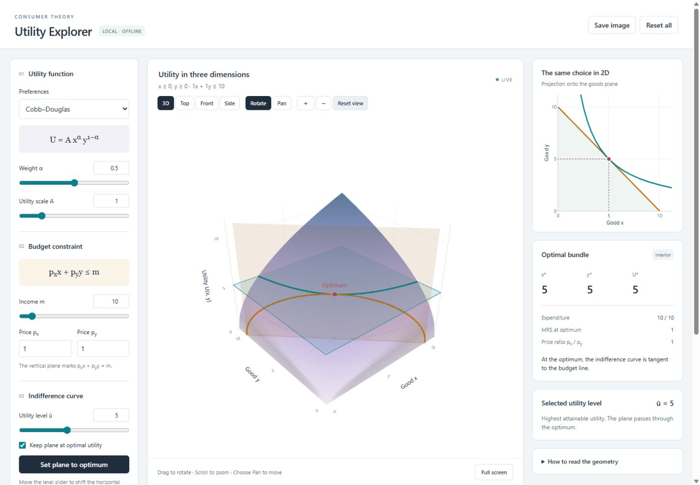

# Utility Explorer

Explore consumer choice with a 3D utility surface, indifference curves, a budget plane, and the optimal bundle.

**[Open the interactive tool](https://qgallea.github.io/utility-explorer/)** — runs in your browser. No account or installation required.



## Use the tool

1. Drag the graph to **rotate**, scroll to **zoom**, or select **Pan** and drag to move the view.
2. Choose a utility function and adjust its parameters. On a narrow screen, click **Controls** to open the settings.
3. Move **Utility level ū** to shift the horizontal plane. Its intersection with the surface is an indifference curve; the linked 2D plot shows its projection onto the goods plane.
4. Change **Income m**, **Price pₓ**, or **Price pᵧ** to move the vertical budget plane. The optimal bundle updates automatically.
5. Click **Set plane to optimum** to show the highest affordable utility level. Keep the checkbox selected to follow the optimum as parameters change.

Use **Visible layers** to hide individual elements or adjust surface opacity. **Full screen** enlarges the 3D plot, **Reset view** restores the camera, and **Save image** exports a PNG.

The goods axes stay fixed by default so budget changes visibly move the plane. Under **Plot range**, change the limits or enable automatic fitting to the budget intercepts.

### Try an example

Start with the default Cobb–Douglas function, income 10, and both prices equal to 1. The optimum is x* = 5, y* = 5, U* = 5. Lower the utility plane to 3, then click **Set plane to optimum** to see the IC reach tangency with the budget line.

## Utility functions

| Preferences | Utility function |
| --- | --- |
| Cobb–Douglas | A x^α y^(1−α) |
| CES | A [αx^ρ + (1−α)y^ρ]^(1/ρ); ρ = 0 uses Cobb–Douglas |
| Perfect substitutes | A [αx + (1−α)y] |
| Perfect complements | A min(x/α, y/(1−α)) |
| Quasilinear | A [α ln(1+x) + (1−α)y] |

Quantities are nonnegative; prices, income, and A are positive. The optimizer uses analytical solutions and handles interior optima, corners, kinks, and multiple optima. For substitutes with equal utility per unit of expenditure, every bundle on the budget line is optimal; the dot shows one example.

Surfaces and curves are sampled for display. The plot range does not constrain the optimizer. Transparent surfaces can overlap visually; use the layer controls or the 2D plot to inspect intersections.

## Run offline

Download the repository using **Code → Download ZIP**, extract it, and open **Utility Explorer.html** in a browser with WebGL enabled. That single file contains the app and plotting library and works without an internet connection.

## Edit and verify

The editable sources are `index.html`, `style.css`, `app.js`, and `model.js`. Node.js is needed only for the commands below; there are no packages to install.

```sh
node test-model.cjs  # Check optimization and indifference curves
node build.cjs       # Rebuild the portable offline HTML
node serve.cjs       # Preview at http://127.0.0.1:8765
```

The model checks cover 225 parameter combinations, compare optima against an independent numerical search along the budget line, and verify feasibility, scale invariance, MRS conditions, and IC values.

GitHub Pages serves `index.html` and its local assets from the root of the `main` branch. After source changes, rebuild the portable file and push both the sources and the rebuilt file.

## Plotting library

Plotly.js 3.1.0 is bundled locally under its [MIT license](vendor/LICENSE-plotly.txt). The app does not need a CDN at runtime.
